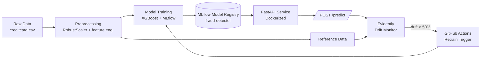

# Fraud Detection MLOps Pipeline

[](https://github.com/YOUR_USERNAME/fraud-detection-mlops/actions/workflows/mlops-pipeline.yml)


A production-oriented fraud detection system built on the **ULB Credit Card Fraud dataset** (284,807 transactions, 0.17% fraud rate). This project demonstrates the full ML lifecycle — from raw data to a containerized prediction API, experiment tracking, drift monitoring, and CI/CD-driven retraining.

---

## Architecture



<details>
<summary>ASCII fallback</summary>

```
Raw Data ──► Preprocessing ──► Training (XGBoost) ──► MLflow Registry
                                                             │
                                                             ▼
                                                    FastAPI (Docker)
                                                             │
                                                             ▼
                                                      POST /predict
                                                             │
                     Reference Data ──► Evidently Drift Monitor
                                                             │
                                              drift > 50% ───┴──► GitHub Actions → Retrain
```
</details>

---

## Results

| Metric | Score |
|---|---|
| **PR-AUC** (primary) | **0.873** |
| ROC-AUC | 0.975 |
| Recall @ 0.5 threshold | 0.837 |

> PR-AUC is the headline metric here, not accuracy or ROC-AUC. On a 0.17% fraud rate, a model that predicts "not fraud" for every transaction would score **99.83% accuracy** while catching zero fraud. PR-AUC measures performance on the minority class that actually matters.

---

## Tech Stack

**Data & Modeling:** Python 3.10, pandas, scikit-learn, XGBoost
**Experiment Tracking:** MLflow (tracking + model registry)
**Serving:** FastAPI, Uvicorn, Pydantic
**Containerization:** Docker
**Monitoring:** Evidently
**CI/CD:** GitHub Actions
**Testing:** pytest, httpx

---

## Project Structure

```
fraud-detection-mlops/
├── .github/workflows/
│   └── mlops-pipeline.yml     # CI: test → drift check → retrain → build
├── app/
│   ├── main.py                # FastAPI app + /predict, /health
│   └── schemas.py             # Pydantic request/response models
├── src/
│   ├── config.py              # Centralized paths and constants
│   ├── preprocessing.py       # Feature engineering + train/test split
│   └── train.py               # XGBoost training + MLflow logging
├── monitoring/
│   └── drift_detector.py      # Evidently drift report generator
├── tests/
│   └── test_api.py            # API contract tests
├── Dockerfile
├── requirements.txt
└── README.md
```

---

## Quickstart

### 1. Install dependencies

```bash
python3 -m venv .venv
source .venv/bin/activate
pip install -r requirements.txt
```

### 2. Download the data

Download `creditcard.csv` from [Kaggle — Credit Card Fraud Detection](https://www.kaggle.com/datasets/mlg-ulb/creditcardfraud) and place it in `data/creditcard.csv`.

### 3. Preprocess

```bash
python -m src.preprocessing
# → Train shape: (227845, 30), Test shape: (56962, 30)
```

### 4. Train and register the model

```bash
python -m src.train
# → Registered model 'fraud-detector' created.  Version 1
```

### 5. Serve the API

```bash
python -m uvicorn app.main:app --reload --port 8000
```

- Interactive docs: **http://127.0.0.1:8000/docs**
- Health check: `curl http://127.0.0.1:8000/health`

### 6. Run tests

```bash
python -m pytest tests/ -v
```

---

## API Usage

**Predict a single transaction:**

```bash
curl -X POST http://127.0.0.1:8000/predict \
  -H "Content-Type: application/json" \
  -d '{"features": [-1.35,-0.07,2.53,1.37,-0.33,0.46,0.23,0.09,0.36,0.09,-0.55,-0.61,-0.99,-0.31,1.46,-0.47,0.20,0.02,0.40,0.25,-0.01,0.40,-0.07,-0.09,0.28,0.51,-0.23,0.03,12.0,-0.31]}'
```

```json
{
  "fraud_probability": 0.0213,
  "is_fraud": false,
  "threshold": 0.5
}
```

The `features` array expects 30 values: **V1–V28 (PCA components), hour_of_day, scaled_amount**.

---

## Docker

```bash
docker build -t fraud-api .
docker run -p 8000:8000 fraud-api
```

The image runs as a **non-root user** and uses a multi-stage build to keep the final layer small.

---

## Drift Monitoring

`monitoring/drift_detector.py` compares the training distribution (reference) against a simulated drifted batch and produces an HTML report:

```bash
python -m monitoring.drift_detector
# → Share of drifted columns: 73.33%
# → ALERT: Significant drift detected. Triggering retraining.
```

Open `monitoring/drift_report.html` in a browser to inspect per-feature drift scores.

---

## CI/CD Pipeline

`.github/workflows/mlops-pipeline.yml` runs on every push and weekly on a schedule:

1. **Test** — installs dependencies, runs the full pytest suite
2. **Drift Check** — runs the Evidently drift detector
3. **Retrain** *(conditional)* — if drift share > 50%, re-preprocesses and retrains
4. **Build & Push** *(conditional)* — builds the Docker image and pushes to GHCR

---

## Design Decisions

| Decision | Rationale |
|---|---|
| **PR-AUC as primary metric** | Accuracy and ROC-AUC are misleading at a 0.17% fraud rate. PR-AUC focuses on the minority class. |
| **RobustScaler over StandardScaler** | `Amount` is heavily right-skewed with outliers; median/IQR scaling is not distorted by extremes. |
| **`scale_pos_weight` in XGBoost** | Handles class imbalance natively without synthetic oversampling (SMOTE), keeping the pipeline reproducible. |
| **Model loaded at startup, not per request** | Avoids ~200ms MLflow round-trip on every prediction. |
| **Threshold = 0.5** | A production system would tune this against the business cost of false positives vs. false negatives. |

---

## Future Work

- Feature store (Feast) for real-time feature serving
- Deploy to Kubernetes (EKS/GKE) with HPA
- SHAP explanations in the `/predict` response
- MLflow aliases (`@production`) instead of version pinning

---

## Reproduce

```bash
git clone https://github.com/dawitwo/fraud-detection-mlops.git
cd fraud-detection-mlops
python3 -m venv .venv && source .venv/bin/activate
pip install -r requirements.txt
# place creditcard.csv in data/
python -m src.preprocessing
python -m src.train
python -m uvicorn app.main:app --reload
```